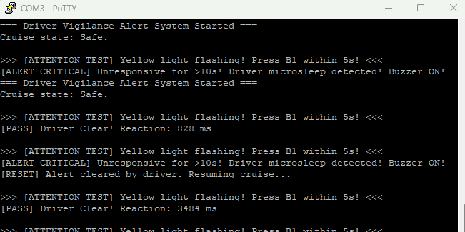

# Driver-Fatigue-Alert-System
# 高危作業／長途駕駛注意力與嗜睡警示檢測儀 (NUCLEO-G474RE 期中專題)

透過隨機抽測與毫秒級按鍵反應捕捉，及時揪出微睡眠並以急促警報喚醒駕駛，所有檢測歷程即時回傳雲端黑盒子。

## 1. 情境故事
長途夜間貨運或高鐵駕駛長時間處於單調環境中，極易進入「微睡眠（Microsleep）」狀態而渾然不覺，釀成重大事故。本裝置模擬車載主動安全系統，在巡航期間每隔 25～40 分鐘（Demo 縮放為 2.5～4.0 秒）隨機發起清醒抽測，以黃燈慢閃作為視覺刺激；駕駛需在 5 秒內拍擊按鍵確認清醒；若超過 10 秒完全無反應，系統判定重度疲勞昏迷，立即觸發紅色急促蜂鳴器警報並上傳雲端黑盒子。

## 2. 替身對照
- **駕駛人拍擊確認鍵** $\leftrightarrow$ **板載藍色按鈕 B1 (PC13)**
- **安全巡航指示燈** $\leftrightarrow$ **板載綠色 LED LD2 (PA5)**（恆亮代表安全）
- **抽測視覺刺激** $\leftrightarrow$ **黃色 LED (PA6)**（2 Hz 慢閃刺激）
- **車載警報蜂鳴器** $\leftrightarrow$ **紅色 LED (PA7)**（10 Hz 超急促暴閃替身蜂鳴器）
- **車載 4G 聯網／黑盒子** $\leftrightarrow$ **電腦終端機 (USART2 via ST-LINK VCP 115200 8N1)**
- **時間縮放** $\leftrightarrow$ **1 秒 = 10 分鐘**（Demo 演示時將等待抽測時間縮短至 2.5～4.0 秒）

## 3. 功能與驗收條件
| 驗收項目 | 操作動作 | 預期反應 | 實測結果 |
| :--- | :--- | :--- | :--- |
| **抽測發起** | 待命 2.5～4.0 秒 | 綠燈熄滅，黃燈以 2 Hz 慢閃，終端機印出抽測提示 | 通過 |
| **正常反應** | 黃燈閃爍後 5 秒內按 B1 | 黃燈熄滅、綠燈恢復恆亮，終端機印出反應毫秒數 `[PASS]` | 通過 |
| **昏睡警報** | 黃燈閃爍滿 10 秒完全不按鍵 | 黃燈維持閃爍，紅燈以 10 Hz 超快閃暴鳴，終端機跳出 `[ALERT CRITICAL]` | 通過 |
| **手動復歸** | 警報暴閃狀態下拍下 B1 | 紅黃燈全熄滅、綠燈恢復恆亮，終端機顯示 `[RESET]` 並重新進入待命 | 通過 |

## 4. 用到的技術（第 3～7 週技術勾選表）
- [x] **GPIO 輸出**：PA5、PA6、PA7 推挽輸出（`MODER = 01`），透過 `BSRR` 控制三色燈號狀態
- [x] **GPIO 輸入**：PC13 讀取 B1 按鍵電位（`MODER = 00`），作為 EXTI 下降緣觸發來源
- [x] **複用功能 AF**：PA2 (TX)、PA3 (RX) 複用模式（`MODER = 10`），`AFR` 暫存器配置為 AF7
- [x] **PLL 170 MHz**：HSI16 $\div 4 \times 85 \div 2$ 升頻至 170 MHz，配置 FLASH 4 latency
- [x] **外部中斷 EXTI**：PC13 外部中斷（`SYSCFG->EXTICR4` 選 PC13，`FTSR1` 下降緣，`IMR1` 致能）
- [x] **NVIC 致能**：使能 TIM2 與 EXTI15_10 中斷向量，響應時基與按鍵事件
- [ ] 優先權與巢狀：沒用到
- [x] **軟體去彈跳**：EXTI 中斷中利用時戳計算 `ms_ticks - last_btn_ms >= 50ms` 排除機械彈跳
- [x] **UART 傳送**：USART2 115200 8N1，檢查暫存器 `ISR` 的 `TXE` 位元後寫入 `TDR` 輸出雲端日誌
- [ ] UART 接收+環形緩衝：沒用到
- [x] **Timer 定時中斷**：TIM2 配置 PSC=169、ARR=999 產生 1 ms 中斷，維護 `ms_ticks` 與閃爍週期
- [ ] PWM：沒用到
- [ ] 輸入捕捉：沒用到

## 5. 腳位表
- `PA5`：LD2 綠色 LED（推挽輸出，安全指示）
- `PA6`：黃色 LED（推挽輸出，抽測視覺刺激）
- `PA7`：紅色 LED（推挽輸出，蜂鳴器警報替身）
- `PC13`：B1 藍色按鈕（輸入，外部中斷 EXTI13 下降緣觸發）
- `PA2`：USART2_TX（AF7 複用功能，ST-LINK VCP 虛擬序列埠）
- `PA3`：USART2_RX（AF7 複用功能）

## 6. 建置與執行
- **硬體**：NUCLEO-G474RE 開發板、USB Type-A 轉 Micro-B / Type-C 傳輸線（依板載接頭）
- **開發環境**：STM32CubeIDE 1.15.0 以上版本
- **燒錄步驟**：
  1. 使用 STM32CubeIDE 開啟本專案
  2. 點擊工具列 **Build (槌子圖示)** 編譯專案
  3. 點擊 **Run (綠色播放圖示)** 燒錄至板子
- **終端機設定**：
  - 軟體：PuTTY / Tera Term / 內建 Terminal
  - 鮑率：115200
  - 資料位元：8
  - 停止位元：1
  - 同位檢查：None
  - 流量控制：None

## 7. 程式結構
- `Core/Src/main.c`：
  - 主迴圈狀態機（`STATE_IDLE`、`STATE_TESTING`、`STATE_ALERT`）維護與逾時判定
  - `HAL_TIM_PeriodElapsedCallback`：TIM2 1ms 中斷，負責累計毫秒時基，並依照狀態對 PA6 (2Hz) 與 PA7 (10Hz) 進行電位切換
  - `HAL_GPIO_EXTI_Callback`：PC13 下降緣中斷，負責 50ms 去彈跳、抽測反應時間計算、及警報手動解除

## 8. 實作照片

*圖一：NUCLEO-G474RE 單板接線與狀態燈運作*

*圖二：USART2 115200 8N1 雲端日誌與反應時間記錄*

## 9. AI 使用說明
- **AI 協作部分**：使用大型語言模型輔助構思狀態機列舉架構、終端機字串格式化以及 README 規格結構骨架。
- **人工查核修正**：
  - 對照 STM32G4 參考手冊重新手算 TIM2 除頻參數（$170\text{ MHz} \div 170 \div 1000 = 1\text{ ms}$）確認無誤。
  - 修正 PC13 按鍵觸發邊緣為下降緣（Falling Edge）以符合板載電路常態拉高邏輯。
  - 檢視軟體去彈跳時間戳比對式，確認無變數溢位與死結風險。

## 10. 已知限制
- 目前隨機間隔採用偽隨機（`ms_ticks % 1501`）計算，未來換真貨時應改由硬體亂數產生器（RNG）或外接 ADC 懸空腳位雜訊作為種子碼。
- 警報蜂鳴器目前以紅色 LED 高速暴閃作為板上替身，實機落地時應改接蜂鳴器致動電路（電晶體驅動主動式蜂鳴器）。
